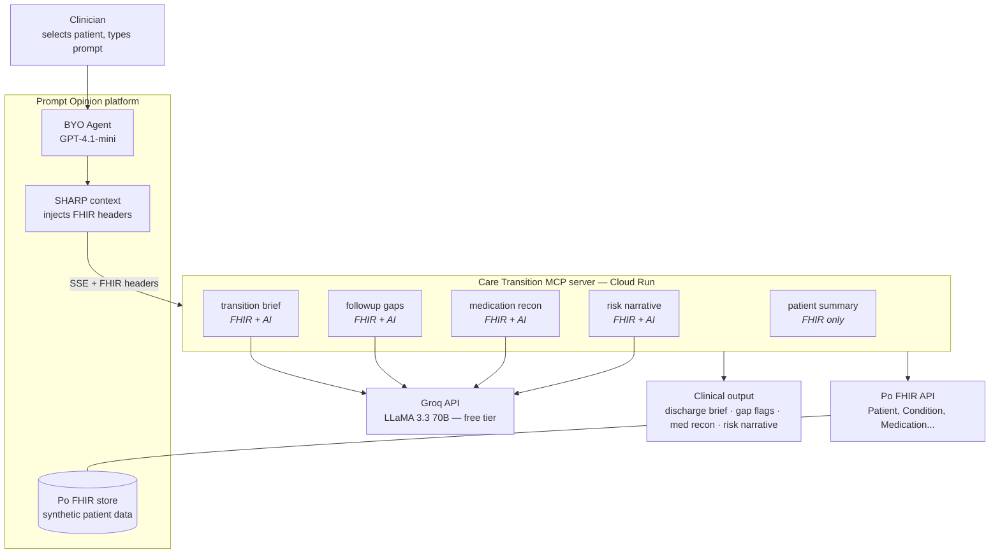

---
# Care Transition MCP

**Five FHIR-grounded tools for safer patient handoffs — built for the Prompt Opinion platform**

A common cause of hospital readmissions isn't clinical — it's a bad handoff. A nurse scrambles to write a discharge summary from scattered records, misses a pending lab result, forgets a follow-up appointment. The patient goes home without the right information, and comes back three weeks later.

This MCP server addresses that directly. Select a patient in Po, ask for a transition brief, and get a structured clinical document in seconds — pulled from the patient's FHIR record, synthesized by AI.

> **Demo only — synthetic data.** This server is a demo built and tested on Po's synthetic EHR data. It has **no authentication**, accepts a caller-supplied FHIR server URL, and has no rate limiting. **Do not use it with real patient data** until authentication, a FHIR host allowlist and rate limiting have been added.

---

## What it does

```
"Generate a care transition brief for this patient being discharged home."
```

The agent calls five tools in sequence:

1. **get_patient_summary** — pulls name, DOB, active conditions, medications from FHIR
2. **generate_transition_brief** — builds a 6-section handoff document
3. **flag_followup_gaps** — flags missing appointments, abnormal labs, medication follow-ups
4. **medication_reconciliation** — checks for duplicates, missing meds, dosage concerns
5. **readmission_risk_narrative** — generates a LOW/MODERATE/HIGH risk assessment with recommended actions

Each tool works independently. Any agent on the Po platform can use any one of them.

---

## Running locally

```bash
git clone https://github.com/rkchellah/Care-Transition-MCP
cd Care-Transition-MCP

pip install -r requirements.txt

cp .env.example .env
# Add GROQ_API_KEY to .env (free at console.groq.com)

python main.py
# Server starts at http://localhost:8080/sse
```

---

## Deploying to Cloud Run

```bash
gcloud run deploy care-transition-mcp \
  --source . \
  --project YOUR_PROJECT_ID \
  --region us-central1 \
  --allow-unauthenticated \
  --port 8080

gcloud run services update care-transition-mcp \
  --set-env-vars GROQ_API_KEY=your_key_here
```

---

## Registering in Po

1. Configuration → MCP Servers → Add MCP Server
2. Endpoint: `https://YOUR_CLOUD_RUN_URL/sse`, Transport: SSE, Auth: None
3. Click Continue — Po will detect the SHARP FHIR extension
4. Toggle on the extension, authorize the FHIR scopes, save

---

## How FHIR context works

When a patient is selected in Po, three HTTP headers are injected into every tool call:

```
X-FHIR-Server-URL:    https://app.promptopinion.ai/api/workspaces/{id}/fhir
X-FHIR-Access-Token:  <bearer token>
X-Patient-ID:         <fhir patient id>
```

The server declares support for this via the SHARP extension in the MCP `initialize` response. A raw ASGI middleware copies the headers into a Python `ContextVar` on every HTTP request.

What tools actually see: with SSE in mcp 1.9.0, a tool call POSTed to `/messages/` is only queued. The tool then runs as a task started from the long-lived `GET /sse` connection, so it reads the headers that arrived **when that connection was opened**, not the headers on the POST. This works today because Po sends the FHIR headers on the initial `GET /sse` connection.

**Known limitation:** if a user switches patient (or the token is refreshed) without the client reconnecting, tools could keep using the previous patient's ID and token. Fixing this properly needs an `mcp` upgrade, in which the POST request is available to tools. That upgrade is deferred.

---

## Stack

- **MCP framework**: FastMCP 1.9.0
- **Transport**: SSE (Server-Sent Events)
- **FHIR**: httpx calling Po's FHIR R4 API
- **LLM**: Groq API — LLaMA 3.3 70B
- **Hosting**: Google Cloud Run
- **Data**: Po synthetic EHR bundle (no real PHI)

---

## What I learned building this

Three bugs that weren't obvious and took real time to solve.

**`BaseHTTPMiddleware` crashes SSE.** I used Starlette's convenience middleware to capture FHIR headers. It crashed immediately with `AssertionError: Unexpected message: http.response.start`. The reason: `BaseHTTPMiddleware` buffers the HTTP response body before passing it downstream. SSE responses don't have a body — they stream indefinitely. Fixed it with a raw ASGI middleware class that passes `scope`, `receive`, `send` directly without touching the response.

**FHIR headers don't reach tool functions via `ctx.request_context.request`.** In SSE transport, that object is the GET `/sse` connection — established once. Tool calls come as POST requests to `/messages/` later, as a different request. I switched to a `ContextVar` set by the middleware on every incoming HTTP request. Correction after review: the value set during the POST does **not** reach the tool. In mcp 1.9.0 the POST handler only queues the message, and the tool runs in a task spawned from the `GET /sse` connection, so it inherits the context set on that GET. It works because Po also sends the headers on the initial connection — see the known limitation under "How FHIR context works".

**Po reads `capabilities.extensions`, not `capabilities.experimental`.** The SHARP spec and Po's own docs describe slightly different fields. FastMCP's `ServerCapabilities` Pydantic model doesn't have `extensions` in its schema, but uses `model_config = ConfigDict(extra="allow")`. Fixed it with injecting via `__pydantic_extra__` and verifying with `model_dump()` before deploying.

---

## Known issues

Listed, not yet fixed:

- **Header context is per connection, not per tool call.** See "How FHIR context works": switching patient without reconnecting could reuse the previous patient. Needs an `mcp` upgrade (deferred).
- **No FHIR paging.** Only the first page of each search is read, so long condition or medication lists can be cut off silently.
- **Blood pressure components are not parsed.** BP is stored as a component Observation with no `valueQuantity`, so it shows as `?`.
- **Abnormal-lab detection relies on interpretation codes only.** `referenceRange` is ignored, so labs without an interpretation code are never flagged.
- **Risk level is LLM-generated, not a validated score** (such as LACE or HOSPITAL).
- **"Medication reconciliation" does not compare two lists.** It reviews the active medication list and short encounter notes; it does not compare home, inpatient and discharge medications.
- **Unauthenticated endpoint with a caller-supplied `X-FHIR-Server-URL`.** Anyone who can reach the server can make it fetch an arbitrary URL (SSRF risk) and spend the Groq quota.
- **No logging and limited tests.** There is no audit logging; tests cover only the FHIR access-failure handling.

When the FHIR server refuses access (401/403) to a resource, tools now report it explicitly (for example `Conditions: ACCESS DENIED (HTTP 403) - verify manually`) instead of treating the list as empty.

---

## Project structure

```
care-transition-mcp/
├── main.py                          # MCP server, SHARP extension, middleware
├── fhir/client.py                   # FHIR API calls using Po headers
├── llm/groq_client.py               # Groq client
├── tools/
│   ├── patient_summary.py
│   ├── transition_brief.py
│   ├── followup_gaps.py
│   ├── medication_reconciliation.py
│   └── readmission_risk.py
├── tests/                           # python -m unittest discover tests
├── Dockerfile
└── requirements.txt
```

---
